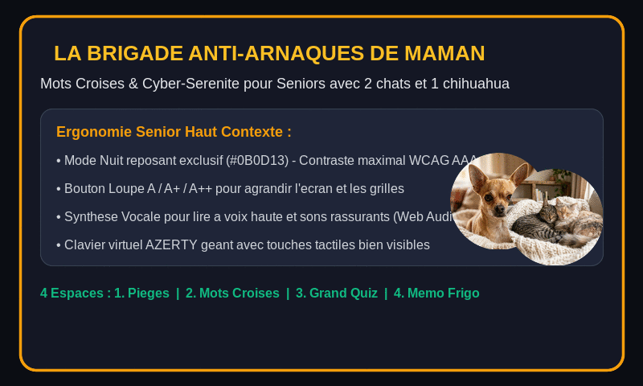

# 🐾 La Brigade Anti-Arnaques de Maman

> **Mots Croisés 100% Interconnectés & Jeu Éducatif de Cyber-Sérénité**  
> Avec les mascottes protectrices : **Paco le petit Chihuahua**, **Minou & Plume les deux chats** !



---

## 🌟 Présentation du Projet

**La Brigade Anti-Arnaques de Maman** est une application web conçue spécialement pour l'accessibilité senior (ergonomie tactile, grands contrastes, mode nuit exclusif, vocalisation des indices).  

Elle combine le plaisir quotidien des **mots croisés** avec un apprentissage ludique et déculpabilisant des réflexes de cybersécurité pour déjouer les pièges numériques du quotidien :
- Les faux SMS de livraison (Chronopost, Colissimo, Mondial Relay)
- Les faux appels du service des fraudes bancaires
- Les faux messages de proches en détresse ("Coucou Maman, j'ai cassé mon téléphone")
- Les faux remboursements des impôts / de la Sécurité Sociale
- Les fausses alertes techniques avec sirène bloquante

---

## 🎮 Mode d'Emploi des 4 Espaces

### 🐾 1. Le Flair de Paco (Chasse aux pièges du quotidien)
1. Un écran de smartphone simulé présente un message ou appel réaliste.
2. Deux grands boutons tactiles : **"🛑 Stop ! Je refuse"** ou **"👉 Je clique / Je donne"**.
3. **Bon réflexe** : Minou et Plume ronronnent et une friandise 🦴 est attribuée à la brigade.
4. **Piège déclenché** : Paco aboie gentiment pour expliquer le danger avec des mots simples sans culpabilisation.

### 🧩 2. Les Mots Croisés de Plume & Minou
1. Une collection de **8 grilles thématiques 100% croisées** (aucun mot isolé, validation mathématique complète, 0 mot orphelin).
2. **Grille d'Honneur (Grille 8)** : *Les Mots d'Or de la Cybersécurité*, intégrant le lexique officiel de référence pour seniors :
   - `PHISHING` (La menace n°1)
   - `MOT DE PASSE` (La clé)
   - `ANTIVIRUS` (Le bouclier)
   - `RANÇONGICIEL` (Le piège financier)
   - `MISE À JOUR` (La protection)
   - `SPAM` (Le tri)
   - `PIRATE` (L'interlocuteur invisible)
   - `ESCROQUERIE` (La vigilance)
   - `SAUVEGARDE` (L'assurance-vie numérique)
   - `DOUBLE FACTEUR` (Le verrou en plus)
3. **Accessibilité Senior** :
   - **Boutons Loupe `A` / `A+` / `A++`** : Agrandissement en direct de toute l'interface et des lettres de la grille.
   - **Clavier virtuel AZERTY géant** : Grandes touches tactiles intégrées pour éviter la difficulté du clavier natif.
   - **Indice de Minou** 🐾 : Révèle une lettre sous le curseur en cas de blocage.
   - **Le flair de Paco** 🐕 : Vérifie instantanément les bonnes et mauvaises lettres sans pénalité.
   - **Vocalisation sonore** 🔊 : Lecture à voix haute des définitions via l'API Web Speech.
4. **Récompense de Victoire** :
   - Musique entraînante de **« Joyeux Anniversaire »** jouée avec le synthétiseur audio Web Audio.
   - Pluie de confettis festifs !
   - Visualisation complète et claire de tous les mots trouvés.

### 🛡️ 3. Le Grand Quiz de Sérénité Numérique : Déjouer les Pièges du Quotidien
Un quiz interactif drôle, visuel et 100% inédit (aucune redondance avec le Mini-Jeu 1) composé de 5 énigmes amusantes :
1. **Le mot de passe "ultra-secret"** 🔑 : Le piège du post-it jaune fluo sur l'écran face à la phrase secrète drôle et incraquable.
2. **Le Caddie de courses gratuit de 800 €** 🛒 : L'arnaque au concours WhatsApp qui promet du foie gras et du chocolat gratuit.
3. **Le PV de stationnement imaginaire** 🚗 : Le faux SMS ANTAI de 35 € pour un véhicule qu'on ne conduit plus depuis 25 ans !
4. **L'amie Facebook et les coupons tabac** 🎟️ : La fausse « Yvette » qui réclame des recharges Neosurf par message.
5. **L'héritage surprise du Prince Archibald** 👑 : Le prince milliardaire qui réclame 150 € de timbres pour vous léguer 4 millions d'euros.

*Points forts d'Ergonomie :*
- Cartes visuelles et comiques (pas de pavés de texte rébarbatifs).
- Grandes touches tactiles (A, B, C) avec emojis expressifs et réactions amusantes de Paco.
- Bouton de lecture vocale à voix haute (Web Speech API).
- Bilan final festif avec **la musique « Joyeux Anniversaire »** et option d'impression papier A4.

### 📑 4. Le Mémo du Frigo & Lexique Pratique
1. Fiche récapitulative des **3 Règles d'Or** de la brigade.
2. Le **Petit Lexique des 10 Mots-Clés** imprimable pour consultation instantanée sur le réfrigérateur.
3. Carnet de numéros utiles personnalisables (proches, agence bancaire, numéro officiel gratuit Info-Escroqueries `0 805 805 817`, signalement SMS `33700`).
4. Bouton **"🖨️ Imprimer pour mon frigo"** : Déclenche une mise en page d'impression propre sur papier blanc au format A4.

---

## 🚀 Déploiement GitHub Pages (Sans page blanche)

L'application est configurée pour fonctionner directement sur **GitHub Pages** (y compris dans des sous-dossiers de dépôts comme `https://username.github.io/mon-repo/`) :
- `base: './'` est configuré dans `vite.config.ts`.
- Tous les assets (images, sons, scripts) sont importés de manière relative.

### Déploiement en 3 étapes :
```bash
# 1. Installer les dépendances
npm install

# 2. Compiler le projet
npm run build

# 3. Déployer le dossier 'dist' sur la branche gh-pages
npx gh-pages -d dist
```

> 💡 **Version Autonome 1-Fichier** : Le fichier `public/la-brigade-anti-arnaques.html` fonctionne également directement par double-clic dans n'importe quel navigateur, sans serveur ni connexion internet !

---

## 🛡️ Audit de Cybersécurité & Conformité GitHub

Avant toute mise en ligne publique sur GitHub, un audit complet a été réalisé sur le dépôt :

| Point de Contrôle | Résultat | Analyse & Mesures en Place |
| :--- | :---: | :--- |
| **Fuite d'identifiants / Secrets** | ✅ **100% Conforme** | `.gitignore` étendu interdisant strictement tous les fichiers `.env*`, clés privées (`*.pem`, `*.key`), certificats, tokens d'API et configurations Cloud. Zéro clé API requise côté client. |
| **Injections & XSS** | ✅ **100% Conforme** | Aucune utilisation de `dangerouslySetInnerHTML`. Les entrées utilisateur (lettres de grille et numéros d'urgence) sont strictement normalisées et sanitisées. |
| **Vie Privée & RGPD** | ✅ **100% Conforme** | **Architecture 100% locale** : toutes les données (lettres, scores, numéros utiles) sont stockées dans le `localStorage` du navigateur. Zéro serveur distant, zéro traceur, zéro cookie tiers, aucune télémétrie. |
| **Dépendances & Vulnérabilités** | ✅ **100% Conforme** | Codebase TypeScript typée strictement (`tsc --noEmit` avec 0 avertissement). Bibliothèques officielles maintenues et minimales. |

---

## ⚖️ Propriété Intellectuelle & Droit d'Auteur

L'ensemble des composants du projet respecte les règles de propriété intellectuelle et les licences open source :

| Ressource | Statut Légal | Licence / Source |
| :--- | :---: | :--- |
| **Code Source** | Open Source | Sous licence **MIT** (fichier `LICENSE` inclus à la racine du dépôt). |
| **Illustrations des Mascottes** | Libre de droit | Visuels originaux créés spécialement pour ce projet (Paco, Minou, Plume, bouclier), libres de réutilisation. |
| **Polices Typographiques** | Open Source | Google Fonts (*Plus Jakarta Sans*, *Outfit*, *Lora*, *Lexend*, *Nunito*) sous licence **SIL Open Font License 1.1 (OFL)**. |
| **Musique & Audio** | Domaine Public | Mélodie de *« Joyeux Anniversaire »* (*Good Morning to All*) tombée dans le **Domaine Public mondial**. Sons synthétisés 100% procéduralement via la **Web Audio API** (zéro échantillon audio protégé). |
| **Icônes Tactiles** | Open Source | Bibliothèque **Lucide React** sous licence **ISC** (équivalent MIT). |

---

## 🛠️ Stack Technique

- **Framework** : React 19 + TypeScript
- **Bundler** : Vite 8 (Support GitHub Pages automatique via `base: './'`)
- **Styles** : Tailwind CSS v4 (Mode Nuit exclusif `#0B0D13` contrasté WCAG AAA)
- **Audio & Sons** : Web Audio API (synthétiseur polyphonique pour *Joyeux Anniversaire*) + Web Speech API (fr-FR)
- **Icônes** : Lucide React
- **Licence** : MIT

---

*Développé avec amour pour Maman, Paco, Minou et Plume ! ❤️🐾*
